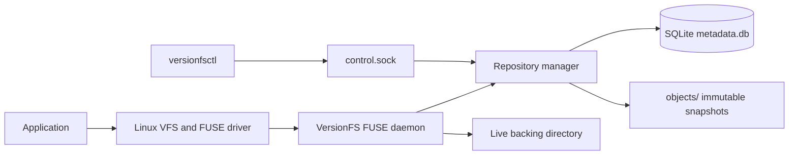

# VersionFS Design

## Design goal

VersionFS is a stackable userspace versioned filesystem. It keeps live files in an ordinary backing directory and adds version history beside them. This keeps the project focused on FUSE request handling, POSIX semantics, metadata, persistence ordering, and recovery—not block allocation or a custom live-data format.

The central invariant is:

> Before VersionFS performs a destructive mutation on a regular file, the file's previous content and metadata are durably recorded as an immutable version.

## Components and request path



The high-level FUSE adapter converts a mount-relative path into a backing path, rejects the reserved `/.versionfs` namespace, and calls the backing filesystem through POSIX syscalls. The repository manager owns version-sensitive work. `versionfsctl` sends requests through the daemon's private Unix-domain socket rather than editing the backing store directly.

## Storage layout and metadata

```text
<source>/
├─ ordinary-live-files
└─ .versionfs/
   ├─ metadata.db
   ├─ metadata.db-wal              # while SQLite WAL is active
   ├─ objects/<version-id>.blob
   ├─ tmp/<version-id>.blob.tmp
   └─ control.sock
```

| Table | Important fields | Purpose |
| --- | --- | --- |
| `files` | stable UUID, `current_path`, `last_path`, deleted flag/timestamp | Preserves file identity across rename and deletion. |
| `versions` | UUID, file UUID, sequence, event, path, object name, checksum, stat metadata | Describes an immutable pre-change state. |

Version objects are complete regular-file copies. This is not the most space-efficient policy, but it makes storage and recovery behavior simple and visible for the MVP.

## Mutation and snapshot protocol

| Trigger | Preserved state | Notes |
| --- | --- | --- |
| First `write` in a writable open session | Current file | One snapshot per handle. |
| `O_TRUNC` or `truncate` | File before size change | Captured before truncation. |
| `chmod`, `chown`, `utimens` | File and stat metadata | Metadata-only changes preserve prior state. |
| `unlink` | Final live contents | The file becomes a deletion tombstone. |
| Rename over destination | Destination before replacement | Source identity follows its new path. |
| Plain rename | No extra copy | Stable UUID moves to the new path. |

```mermaid
sequenceDiagram
    participant App as Application
    participant F as FUSE callback
    participant R as Repository manager
    participant O as Object store
    participant DB as SQLite
    participant Live as Backing file
    App->>F: destructive POSIX operation
    F->>R: lock mutation and request snapshot
    R->>Live: read bytes and stat metadata
    R->>O: write temporary object and fsync
    R->>O: atomic rename object and fsync directory
    R->>DB: transaction inserts version; COMMIT
    R-->>F: previous state is durable
    F->>Live: perform live operation
    F-->>App: return POSIX result
```

The ordering is the crash-safety mechanism. Before the SQLite commit, the live operation has not begun. After it, the committed version points to a fully synced immutable object.

## Rename, deletion, and restoration

Every tracked regular file has a stable UUID. A plain rename updates the UUID's current path, so history follows the file rather than remaining at its old pathname. Renaming over another file snapshots and tombstones the destination first.

Deletion snapshots final live content and clears `current_path`, leaving `last_path` and a deletion timestamp. Restore either snapshots and replaces a current live file, reactivates a deleted identity at its original path, or creates a new identity when `--to` is supplied. Restore is rejected while the target has an active writable handle.

## Concurrency, caching, and recovery

Mutating callbacks take a repository mutation lock. This serializes version creation and its live operation, yielding deterministic history order under concurrent writers. The trade-off is reduced write parallelism, which is acceptable for an instructional MVP and measurable in benchmarks.

SQLite uses WAL mode, full synchronous commits, and foreign keys. Startup runs `PRAGMA quick_check` and removes only unfinished files in `.versionfs/tmp`; published but unreferenced objects are retained for audit. `versionfsctl verify` recalculates SHA-256 for every referenced object.

The backing directory is private while mounted: external modifications bypass VersionFS locks and cannot be versioned. The design provides per-operation durability, not multi-file transactions.

## Limits and future work

Future work could add deduplication, compression, retention policies, garbage collection, hard-link identity, xattrs/ACLs, sparse-file awareness, file locking, and stronger path-resolution protections against hostile symlink layouts.
